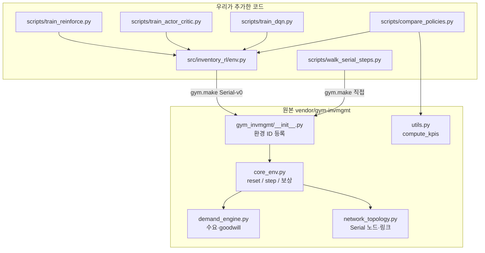
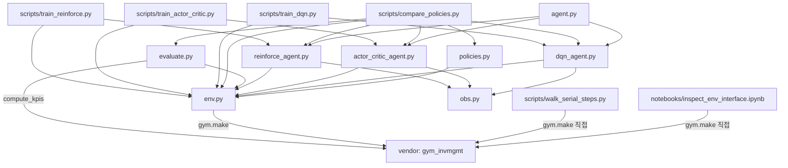

# 파일 구조

이 프로젝트는 두 층이다.

- **원본 시뮬레이터** `vendor/gym-invmgmt` — 가져온 파일을 수정하지 않는다.
- **우리가 추가한 코드** `src/`, `scripts/`, `notebooks/`, `docs/` — 학습·비교·설명.

학습 정책은 세 개다.

- REINFORCE: 연속 발주, 에피소드 수익 $G_t$
- actor-critic: 연속 발주, 매 기간 TD 오차 $\delta_t$
- DQN: 이산 발주 `{0, 20, 40, 60, 80}`

## 1. 폴더 한눈에

```text
inventory-rl-project/
├── vendor/gym-invmgmt/          원본 환경 (수정하지 않음)
├── src/inventory_rl/            우리가 추가한 학습·기준선·평가
├── scripts/                     실행 진입점
├── notebooks/                   환경 인터페이스 확인
├── docs/                        설명 문서
├── outputs/                     학습 결과 (체크포인트, 표, 곡선)
├── requirements.txt
└── README.md
```

실행할 때 보는 파일만 고르면 아래 여섯 개다.

| 하고 싶은 일 | 실행 |
|---|---|
| 환경을 한 기간씩 보기 | `python scripts/walk_serial_steps.py` |
| REINFORCE 학습 | `python scripts/train_reinforce.py` |
| actor-critic 학습 | `python scripts/train_actor_critic.py` |
| DQN 학습 | `python scripts/train_dqn.py` |
| 다섯 정책 비교 | `python scripts/compare_policies.py` |
| reset/step 노트북 | `notebooks/inspect_env_interface.ipynb` |

누가 누구를 호출하는지는 아래 2–7절, 수업 식과 읽는 순서는 8–9절이다.

## 2. 원본과 우리 코드



원본에서 실제로 건드리는 지점은 세 곳이다.

- `gym.make("GymInvMgmt/Serial-v0", ...)` → `core_env.py` 의 `reset`/`step`
- 보상 식은 `core_env.py` 의 `_STEP`
- 비교 KPI는 `gym_invmgmt.utils.compute_kpis`

## 3. 우리가 추가한 파일

```text
src/inventory_rl/
├── env.py                 환경 생성. 수요 설정, 발주 상한 80
├── obs.py                 관측 15칸을 나눠 신경망 입력으로
├── reinforce_agent.py     가우시안 정책 + REINFORCE 업데이트
├── actor_critic_agent.py  가우시안 정책 + TD actor-critic 업데이트
├── dqn_agent.py           이산 발주 125칸 + DQN 업데이트
├── policies.py            고정 발주, 재고 수준 (학습 없음)
├── evaluate.py            에피소드 실행 + KPI 평균
├── agent.py               학습 에이전트를 다시 export
└── __init__.py            ReinforceAgent, ActorCriticAgent, DQNAgent

scripts/
├── walk_serial_steps.py   환경 설명. inventory_rl 을 거치지 않음
├── train_reinforce.py     REINFORCE 학습 진입점
├── train_actor_critic.py  TD actor-critic 학습 진입점
├── train_dqn.py           DQN 학습 진입점
└── compare_policies.py    비교 진입점

notebooks/inspect_env_interface.ipynb
docs/rl_comparison.md
docs/file_structure.md     이 파일
```

## 4. import 관계

화살표는 “이 파일이 저 파일을 import 한다”이다.



한 줄로 말하면:

- **REINFORCE 학습**은 `train_reinforce.py` → `ReinforceAgent` + `make_serial_env`
- **actor-critic 학습**은 `train_actor_critic.py` → `ActorCriticAgent` + `make_serial_env`
- **DQN 학습**은 `train_dqn.py` → `DQNAgent` + `make_serial_env`
- **비교**는 `compare_policies.py` → 고정 발주·재고 수준·REINFORCE·actor-critic·DQN + `evaluate_policy`
- **설명**은 `walk_serial_steps.py` / 노트북이 원본 `gym.make`를 직접 호출한다. `src/inventory_rl` 을 거치지 않는다.

`agent.py` 는 다른 스크립트가 쓰지 않는다. `from inventory_rl.agent import ...` 를 쓰고 싶을 때 있는 별칭이다.

체크포인트가 없으면 비교 스크립트는 그 학습 정책만 빼고 나머지를 출력한다.

## 5. 실행 흐름

### 학습 `train_reinforce.py`

```text
make_serial_env()
    → ReinforceAgent
        → 에피소드마다
              act_and_log(관측) → env.step(발주) 를 30기간
              update_episode(...)          # 에피소드가 끝난 뒤에 한 번, G_t − V(s)
    → outputs/.../reinforce.pt
    → outputs/.../reinforce_train_log.csv
    → outputs/.../reinforce_train_return.png
```

`reinforce_agent.py` 가 `obs.scale_obs` 로 관측을 나눈 뒤 신경망에 넣는다.

### 학습 `train_actor_critic.py`

```text
make_serial_env()
    → ActorCriticAgent
        → 매 기간
              act_and_log(관측) → env.step(발주)
              learn_step(...)              # δ = r + γV(s') − V(s)
    → outputs/.../actor_critic.pt
    → outputs/.../actor_critic_train_log.csv
    → outputs/.../actor_critic_train_return.png
```

정책 네트워크 모양은 REINFORCE와 같다. 다른 점은 학습 시점이다. REINFORCE는 30기간이 끝난 뒤 $G_t$, actor-critic은 매 기간 TD 오차다.

### 학습 `train_dqn.py`

```text
make_serial_env()
    → DQNAgent
        → 매 기간
              act_and_index(관측) → env.step(이산 발주)
              remember(...) → learn()     # 버퍼가 찬 뒤 매 기간 한 번
    → outputs/.../dqn.pt
    → outputs/.../dqn_train_log.csv
    → outputs/.../dqn_train_return.png
```

`dqn_agent.py` 도 `obs.scale_obs` 로 관측을 나눈다. 링크마다 `{0, 20, 40, 60, 80}` 다섯 칸이라 행동이 125개다.

### 비교 `compare_policies.py`

```text
고정 발주              ConstantOrderPolicy.get_action
재고 수준              BaseStockPolicy.get_action
학습 정책(REINFORCE)    ReinforceAgent.load(reinforce.pt) → get_action
학습 정책(Actor-Critic) ActorCriticAgent.load(actor_critic.pt) → get_action
학습 정책(DQN)          DQNAgent.load(dqn.pt) → get_action
        ↘
     evaluate_policy  (같은 시드, 같은 수요)
        → compute_kpis
        → outputs/.../policy_comparison.csv
```

다섯 정책이 모두 `env.clip_order` 로 발주를 0~80에 맞춘다. DQN은 그 안에서 이산 칸만 고른다.

### 환경 설명 `walk_serial_steps.py`

```text
gym.make("GymInvMgmt/Serial-v0", demand_config=stationary)
    → reset / step 을 한 기간씩 출력
```

수요는 정상 Poisson + goodwill 이다. 학습 기본값 `trend_shock` 과 다르다.

## 6. 산출물이 생기는 곳

`--demand` 에 따라 폴더가 갈린다. `env.output_dir_for_demand` 가 정한다.

| 수요 | 폴더 |
|---|---|
| `trend_shock` (기본) | `outputs/` |
| `stationary` | `outputs/stationary/` |

같은 이름 파일:

- `reinforce.pt` — REINFORCE 가중치
- `reinforce_train_log.csv` — REINFORCE 에피소드별 보상·손실
- `reinforce_train_return.png` — REINFORCE 학습 곡선
- `actor_critic.pt` — actor-critic 가중치
- `actor_critic_train_log.csv` — actor-critic 에피소드별 보상·손실
- `actor_critic_train_return.png` — actor-critic 학습 곡선
- `dqn.pt` — DQN 가중치
- `dqn_train_log.csv` — DQN 에피소드별 보상·손실·ε
- `dqn_train_return.png` — DQN 학습 곡선
- `policy_comparison.csv` — 다섯 정책 KPI

## 7. 원본에서 열어볼 파일

학습 코드를 읽을 때 원본은 이 세 파일이면 충분하다.

| 원본 경로 | 우리 코드와 맞닿는 지점 |
|---|---|
| `vendor/gym-invmgmt/gym_invmgmt/core_env.py` | `reset`, `step`, 보상 `_STEP` |
| `vendor/gym-invmgmt/gym_invmgmt/demand_engine.py` | `env.py` 의 `demand_config` |
| `vendor/gym-invmgmt/gym_invmgmt/utils.py` | `evaluate.py` 의 `compute_kpis` |

토폴로지(노드, 리드타임)는 `network_topology.py` 와 Serial YAML이다. 재고 수준 정책이 그래프에서 `h`, `b`, `L` 을 읽을 때 쓰인다.

## 8. 공부할 때 이 순서로 읽기

원본 시뮬레이터를 먼저 고치지 말고, 우리가 추가한 파일만 위에서 아래로 보면 된다.

1. `src/inventory_rl/env.py` — 환경 생성, 수요 두 종류, 발주 상한 80
2. `src/inventory_rl/obs.py` — 관측 15칸 의미와 스케일
3. `scripts/walk_serial_steps.py` 또는 노트북 — `reset`/`step` 한 기간
4. `src/inventory_rl/policies.py` — 학습하지 않는 두 기준선
5. `src/inventory_rl/dqn_agent.py` — 7강 value-based
6. `src/inventory_rl/reinforce_agent.py` — 8강 REINFORCE + 기준선
7. `src/inventory_rl/actor_critic_agent.py` — 8강 TD actor-critic
8. `scripts/train_*.py` → `scripts/compare_policies.py` → `evaluate.py`

스크립트는 모두 `sys.path.insert(0, ROOT/"src")` 를 해서 `import inventory_rl` 이 된다. `src.` 를 붙이지 않는다.

### 이름 함정

| 이름 | 실제 |
|---|---|
| `reinforce_agent.ActorCritic` | REINFORCE 네트워크. V 는 $G_t$ 기준선 |
| `actor_critic_agent.ActorCriticAgent` | 8강 TD actor-critic |
| `actor_critic_agent.ActorCriticNet` | 그 에이전트의 네트워크 |
| `scripts/train_actor_critic.py` | 예전엔 REINFORCE 별칭. 지금은 TD actor-critic 학습 |

`agent.py` 는 별칭만 export 한다. 학습 스크립트는 각 파일을 직접 import 한다.

## 9. 수업 식과 코드

세 학습 정책이 같은 환경 `Serial-v0` 를 쓰고, 학습 신호만 다르다.

| 수업 | 코드 | 행동 | 업데이트 |
|---|---|---|---|
| 7강 DQN | `dqn_agent.py` `learn()` | 이산 125칸 | $y = r + \gamma \max_{a'} Q_{\theta^-}(s',a')$, MSE |
| 8강 REINFORCE | `reinforce_agent.py` `update_episode()` | 연속 가우시안 | $\nabla \log\pi \times (G_t - V(s))$, 에피소드 끝 한 번 |
| 8강 TD actor-critic | `actor_critic_agent.py` `learn_step()` | 연속 가우시안 | $\delta = r + \gamma V(s') - V(s)$, 매 기간 |

슬라이드에 없고 코드에 있는 것:

- 발주 이산화 `{0,20,40,60,80}` — DQN을 쓰기 위해 우리가 자른 것
- 보상 / 50 — 손실 스케일
- entropy 항 — REINFORCE·actor-critic 이 한 값에 고정되지 않게
- actor-critic 의 backbone 공유 — 슬라이드는 $\theta$ 와 $w$ 를 따로 둠
- Q actor-critic, $Q-V$ advantage 버전은 없음

구현하지 않은 8강 식:

```text
Q Actor-Critic        ∇ log π × Q_w(s, a)
Advantage Actor-Critic ∇ log π × (Q − V)
```

지금 세 번째는 TD actor-critic $\nabla \log\pi \times \delta_t$ 만 있다.
