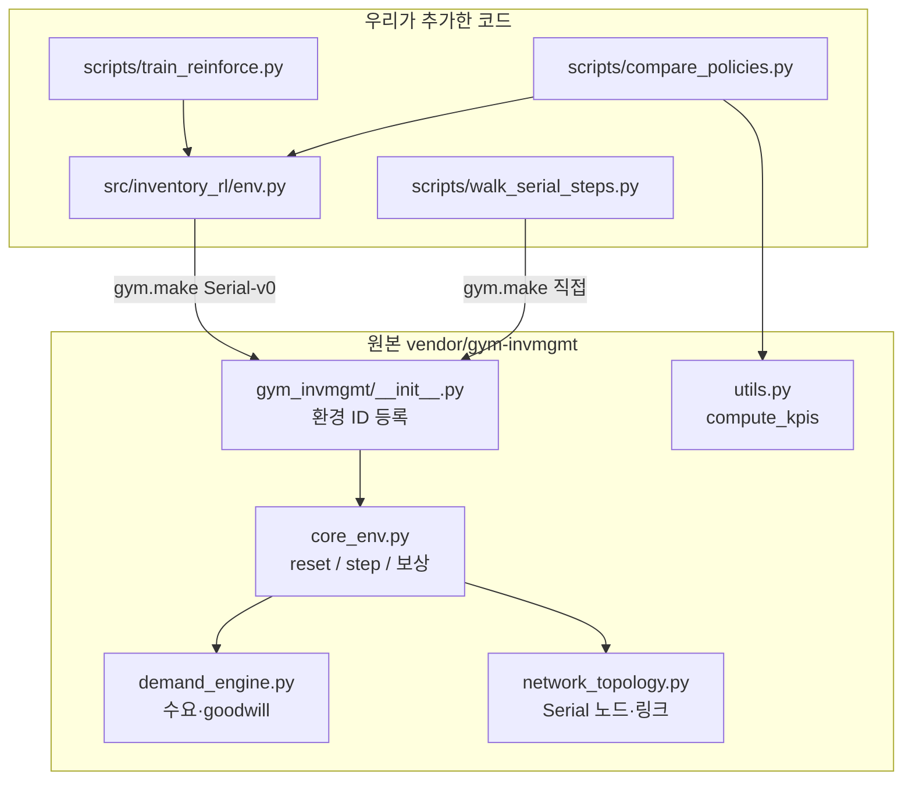
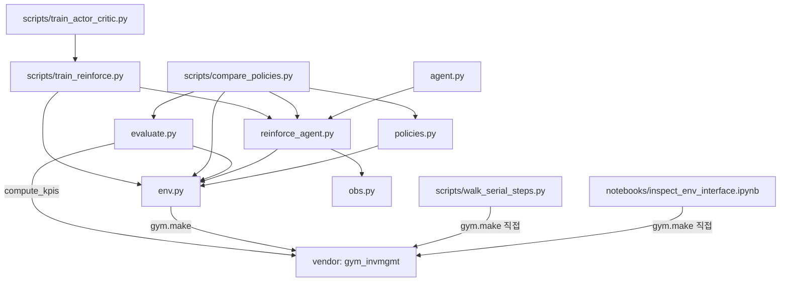

# 파일 구조

이 프로젝트는 두 층이다.

- **원본 시뮬레이터** `vendor/gym-invmgmt` — 가져온 파일을 수정하지 않는다.
- **우리가 추가한 코드** `src/`, `scripts/`, `notebooks/`, `docs/` — 학습·비교·설명.

## 1. 폴더 한눈에

```text
inventory-rl-project/
├── vendor/gym-invmgmt/          원본 환경 (수정하지 않음)
├── src/inventory_rl/            우리가 추가한 학습·기준선·평가
├── scripts/                     실행 진입점
├── notebooks/                   환경 인터페이스 확인
├── docs/                        설명 문서
├── outputs/                     학습 결과 (체크포인트, 표, 곡선)
├── requirements.txt
└── README.md
```

실행할 때 보는 파일만 고르면 아래 네 개다.

| 하고 싶은 일 | 실행 |
|---|---|
| 환경을 한 기간씩 보기 | `python scripts/walk_serial_steps.py` |
| REINFORCE 학습 | `python scripts/train_reinforce.py` |
| 세 정책 비교 | `python scripts/compare_policies.py` |
| reset/step 노트북 | `notebooks/inspect_env_interface.ipynb` |

방법·숫자 설명은 `docs/rl_comparison.md`, 이 파일은 **누가 누구를 호출하는지**만 적는다.

## 2. 원본과 우리 코드



원본에서 실제로 건드리는 지점은 세 곳이다.

- `gym.make("GymInvMgmt/Serial-v0", ...)` → `core_env.py` 의 `reset`/`step`
- 보상 식은 `core_env.py` 의 `_STEP`
- 비교 KPI는 `gym_invmgmt.utils.compute_kpis`

## 3. 우리가 추가한 파일

```text
src/inventory_rl/
├── env.py                 환경 생성. 수요 설정, 발주 상한 80
├── obs.py                 관측 15칸을 나눠 신경망 입력으로
├── reinforce_agent.py     가우시안 정책 + REINFORCE 업데이트
├── policies.py            고정 발주, 재고 수준 (학습 없음)
├── evaluate.py            에피소드 실행 + KPI 평균
├── agent.py               ReinforceAgent 를 다시 export
└── __init__.py            패키지 표시

scripts/
├── walk_serial_steps.py   환경 설명. inventory_rl 을 거치지 않음
├── train_reinforce.py     학습 진입점
├── compare_policies.py    비교 진입점
└── train_actor_critic.py  예전 이름. train_reinforce 로 연결

notebooks/inspect_env_interface.ipynb
docs/rl_comparison.md
docs/file_structure.md     이 파일
```

## 4. import 관계

화살표는 “이 파일이 저 파일을 import 한다”이다.



한 줄로 말하면:

- **학습**은 `train_reinforce.py` → `ReinforceAgent` + `make_serial_env`
- **비교**는 `compare_policies.py` → 세 정책 + `evaluate_policy`
- **설명**은 `walk_serial_steps.py` / 노트북이 원본 `gym.make`를 직접 호출한다. `src/inventory_rl` 을 거치지 않는다.

`agent.py` 는 다른 스크립트가 쓰지 않는다. `from inventory_rl.agent import ReinforceAgent` 를 쓰고 싶을 때 있는 별칭이다.

## 5. 실행 흐름

### 학습 `train_reinforce.py`

```text
make_serial_env()
    → ReinforceAgent
        → 에피소드마다
              act_and_log(관측) → env.step(발주) 를 30기간
              update_episode(...)          # 에피소드가 끝난 뒤에 한 번
    → outputs/.../reinforce.pt
    → outputs/.../reinforce_train_log.csv
    → outputs/.../reinforce_train_return.png
```

`reinforce_agent.py` 가 `obs.scale_obs` 로 관측을 나눈 뒤 신경망에 넣는다.

### 비교 `compare_policies.py`

```text
고정 발주     ConstantOrderPolicy.get_action
재고 수준     BaseStockPolicy.get_action
학습 정책     ReinforceAgent.load(reinforce.pt) → get_action
        ↘
     evaluate_policy  (같은 시드, 같은 수요)
        → compute_kpis
        → outputs/.../policy_comparison.csv
```

세 정책이 모두 `env.clip_order` 로 발주를 0~80에 맞춘다.

### 환경 설명 `walk_serial_steps.py`

```text
gym.make("GymInvMgmt/Serial-v0", demand_config=stationary)
    → reset / step 을 한 기간씩 출력
```

수요는 정상 Poisson + goodwill 이다. 학습 기본값 `trend_shock` 과 다르다.

## 6. 산출물이 생기는 곳

`--demand` 에 따라 폴더가 갈린다. `env.output_dir_for_demand` 가 정한다.

| 수요 | 폴더 |
|---|---|
| `trend_shock` (기본) | `outputs/` |
| `stationary` | `outputs/stationary/` |

같은 이름 파일:

- `reinforce.pt` — 학습된 가중치
- `reinforce_train_log.csv` — 에피소드별 보상·손실
- `reinforce_train_return.png` — 학습 곡선
- `policy_comparison.csv` — 세 정책 KPI

## 7. 원본에서 열어볼 파일

학습 코드를 읽을 때 원본은 이 세 파일이면 충분하다.

| 원본 경로 | 우리 코드와 맞닿는 지점 |
|---|---|
| `vendor/gym-invmgmt/gym_invmgmt/core_env.py` | `reset`, `step`, 보상 `_STEP` |
| `vendor/gym-invmgmt/gym_invmgmt/demand_engine.py` | `env.py` 의 `demand_config` |
| `vendor/gym-invmgmt/gym_invmgmt/utils.py` | `evaluate.py` 의 `compute_kpis` |

토폴로지(노드, 리드타임)는 `network_topology.py` 와 Serial YAML이다. 재고 수준 정책이 그래프에서 `h`, `b`, `L` 을 읽을 때 쓰인다.
